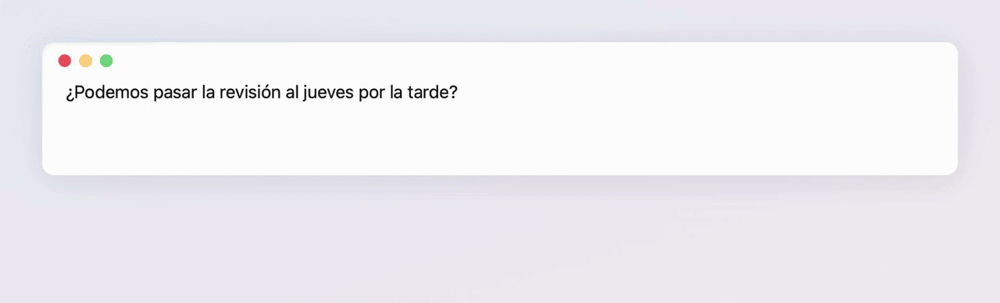
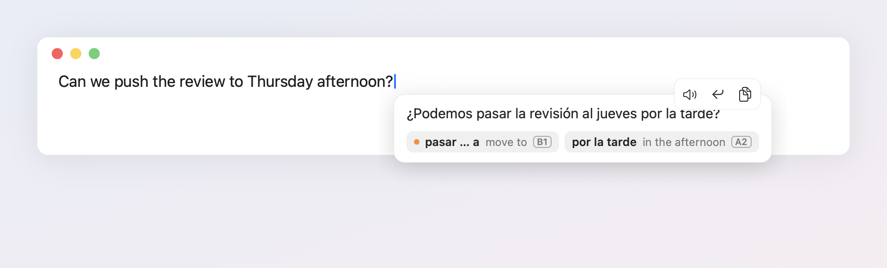
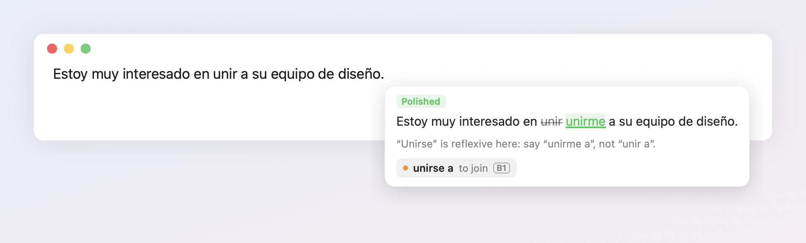
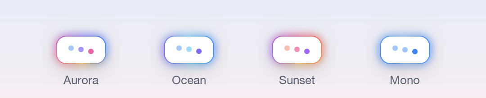
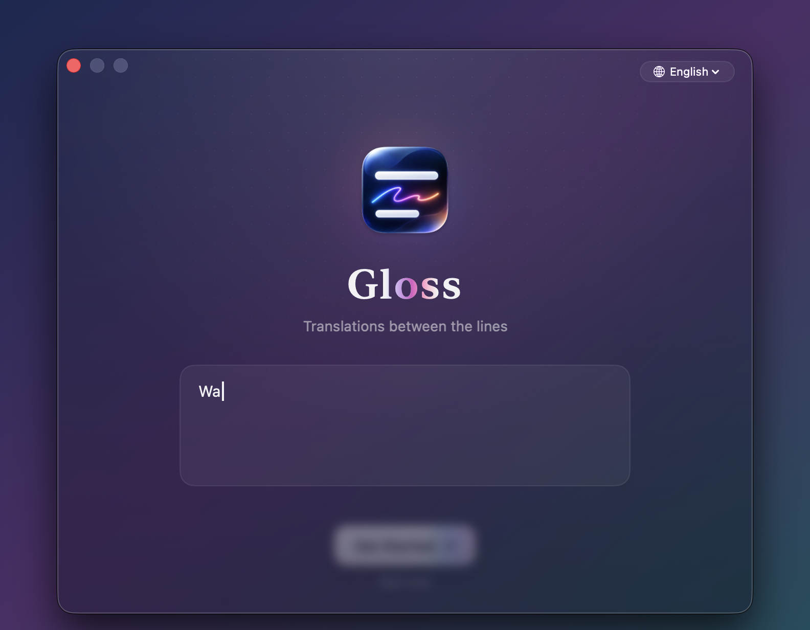
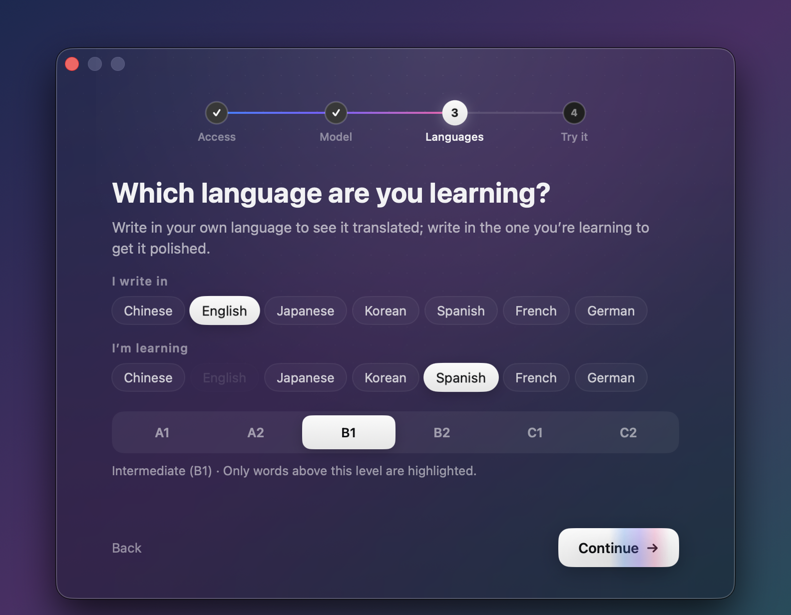
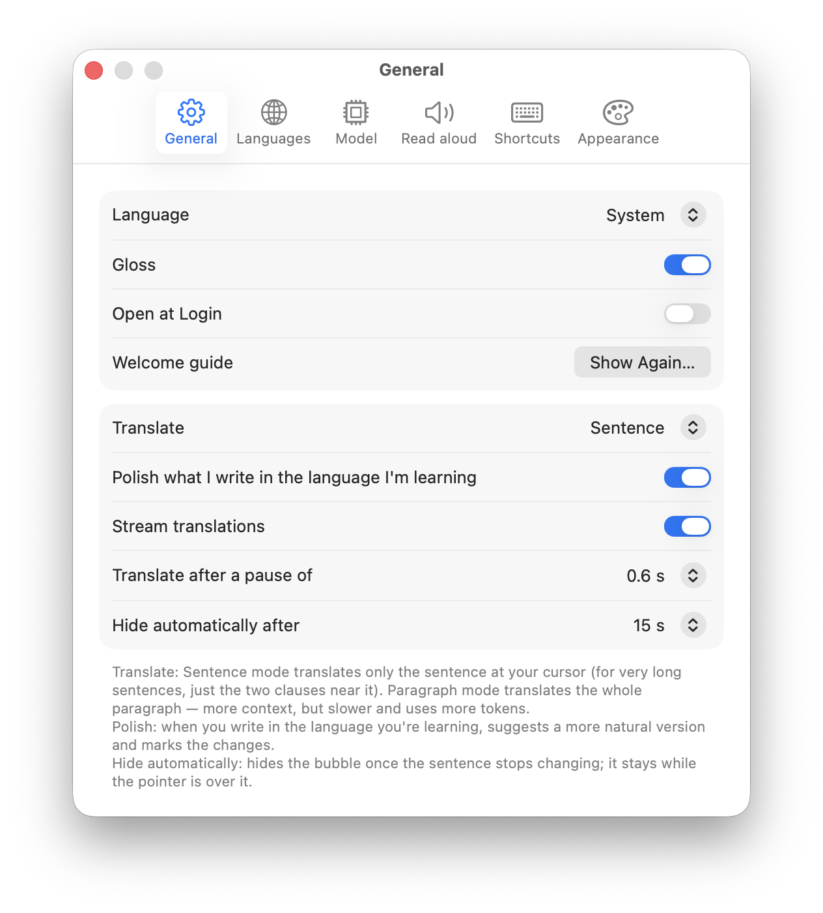

<p align="center">
  
</p>

<h1 align="center">Gloss</h1>

<p align="center">
  Translates the sentence you're typing, in any Mac app, and shows it right below your cursor.
</p>

<p align="center">
  
  
  
  
</p>

<p align="center"><b>English</b> · <a href="README.zh-CN.md">简体中文</a></p>

<p align="center">
  
</p>

Gloss is a menu bar app for people who write in a language they're still learning. Write in your native language and see how to say it in the language you're learning. Write in the language you're learning and Gloss polishes it. New words are collected along the way so you can review them later.

The name comes from the old practice of writing *glosses*, the small translations and notes written between the lines of a text. Its Chinese name, 字里行间, means "between the lines".

## Features

**Works in any text field.** Gloss reads the sentence at your cursor through the macOS Accessibility API, so it works in chat apps, mail, browsers, and editors without plugins. It waits for a short pause (0.6 s by default), skips half-typed pinyin, and ignores password fields, read-only text, and fields that only contain a link.

**Streams as it's generated.** While the model is thinking, the bubble shows a glowing border. Then the translation types itself out word by word.

**Replace, read aloud, copy.** Hover over the bubble for these three buttons. To replace without the mouse, press ⌃⌥E. To read aloud, press ⌃⌥S, or turn on automatic reading.

<p align="center">
  
</p>

**Polishes what you write in the language you're learning.** You get a more natural version, with deletions struck through, additions underlined, and a one-line explanation.

<p align="center">
  
</p>

**Learns your vocabulary.** The model picks 0–3 words worth learning, based on your level (CEFR A1–C2). Words you have seen fewer than three times get an orange dot. Click a word to hear it, or click ✓ to mark it as learned. Words fade out as you keep writing: you review them just by using them. Browse, delete or export them to Anki in the vocabulary window.

**Stays after you hit Return.** In chat apps you usually press Return as soon as you finish typing. Gloss keeps the translation of the message you just sent on screen for a few seconds, marked *Sent*, so you still get to read it.

**Sentence or paragraph.** By default Gloss translates the sentence at your cursor. For a very long sentence, it translates only the two clauses closest to the cursor. Switch to paragraph mode to translate the whole paragraph with full context.

**Bring your own model.** Works with any OpenAI-compatible API, such as DeepSeek, Zhipu GLM, Qwen, Kimi, or OpenAI. You can add, edit, and switch models in Settings.

**Seven languages.** Chinese, English, Japanese, Korean, Spanish, French, and German, both for translation and for the interface.

**Pick your glow.** Choose from four color palettes for the border.

<p align="center">
  
</p>

## Requirements

- macOS 13 Ventura or later, Apple silicon
- An API key for an OpenAI-compatible model service
- Accessibility permission, so Gloss can read and replace text in other apps

## Install

Download `Gloss-<version>.zip` from [Releases](https://github.com/evan-wu-dev/Gloss/releases), unzip it, and move `Gloss.app` to your Applications folder.

Gloss isn't notarized by Apple, so macOS blocks it the first time you open it. To allow it:

- **macOS 15 Sequoia and later**: open Gloss once and close the warning. Then go to **System Settings → Privacy & Security**, scroll down, and click **Open Anyway** next to Gloss.
- **macOS 13–14**: right-click `Gloss.app`, choose **Open**, then click **Open** again.

You can also clear the quarantine flag in Terminal: `xattr -dr com.apple.quarantine /Applications/Gloss.app`.

When you install a newer version, macOS treats it as a different app for Accessibility. If Gloss stops reacting after an update, turn it off and on again under **System Settings → Privacy & Security → Accessibility**.

### Build from source

You need the Xcode command line tools (`xcode-select --install`). Then:

```bash
git clone https://github.com/evan-wu-dev/Gloss.git
cd Gloss
./scripts/build.sh
open dist/Gloss.app
```

The build compiles the sources with `swiftc`, packages `dist/Gloss.app`, and runs a self-test. There is no Xcode project.

By default the app gets an ad-hoc signature. macOS ties the Accessibility permission to the signature, so after each rebuild you need to turn Gloss off and on again under **System Settings → Privacy & Security → Accessibility**. To avoid that, sign with a certificate of your own, such as a free Apple Development certificate. You can pass it on the command line:

```bash
SIGNING_IDENTITY="Apple Development: Your Name (XXXXXXXXXX)" ./scripts/build.sh
```

Or save it once in `scripts/signing-identity`. Git ignores that file. To package a release zip, run `VERSION=x.y.z ./scripts/release.sh`.

## First run

The first time you open Gloss, a short welcome guide walks you through four steps:

1. Grant Accessibility permission.
2. Set up a model (you can skip this and do it later).
3. Choose your languages and level.
4. Try it on a sample sentence.

<p align="center">
  
  
</p>

When you're done, the window flies into the menu bar icon. That's where you'll find Gloss from then on. You can reopen the guide from **Settings → General**.

If the menu bar is too crowded to show the icon, open Gloss again from Spotlight to bring up Settings.

## Using it

| Action | How |
| --- | --- |
| Replace the sentence with the translation | ⌃⌥E, or the ↩ button that appears when you hover over the bubble |
| Read the translation aloud | ⌃⌥S, or the speaker button |
| Copy the translation | The copy button |
| Hear a single word | Click the word |
| Mark a word as learned | Click ✓ next to it, or right-click it |
| Hide the bubble | Esc, or wait 15 s |
| Turn Gloss off | The switch at the top of the menu (the icon turns gray) |

You can change both shortcuts in **Settings → Shortcuts** by clicking a shortcut and pressing a new combination.

## Settings

<p align="center">
  
</p>

| Tab | What's there |
| --- | --- |
| General | Interface language, on/off, Open at Login, welcome guide, sentence or paragraph mode, polishing, streaming, pause before translating, auto-hide delay |
| Languages | Native language, language you're learning, your level (CEFR A1–C2) |
| Model | List of models, switch the active one, add, edit, and delete; extra request parameters under *Advanced* |
| Read aloud | Off, with shortcut, or automatic; voice, speed, and preview |
| Shortcuts | Replace and read-aloud shortcuts |
| Appearance | Glow colors: Aurora, Ocean, Sunset, Mono |

Everything is stored in `~/Library/Application Support/LiveTranslate/config.json`, which you can also edit by hand. The file contains your API keys and is created with `600` permissions.

### Extra parameters

Some model services can "think" before answering, which makes translations slower. In **Model → Edit → Advanced**, you can add parameters that are merged into every request. For example:

- DeepSeek: `{"reasoning_effort":"none"}`
- Zhipu GLM: `{"thinking":{"type":"disabled"}}`

If a service rejects them, Gloss retries once without them. With thinking turned off, DeepSeek usually takes about 1.4 s per sentence; with it on, about 2.8 s.

## Vocabulary and Anki

Words are saved per language in `~/Library/Application Support/LiveTranslate/vocab-<language>.json`. A word counts as seen once each time you finish a sentence, not on every pause.

You review words just by writing. When a word shows up in the popup and you don't click to hear it, it counts as remembered and is shown again only after 1, 3, 7, 15 and 30 days; after that it counts as learned. Clicking a word to hear it starts it over. Words you write yourself in the language you're learning count as learned right away, and words at or below your level are never shown.

**Vocabulary…** in the menu lists your words under Learning and Learned. Search them, listen, mark them as learned, move them back, or delete them (select several and press Delete). **Export to Anki…** in that window writes a tab-separated file to your Downloads folder. In Anki, choose **File → Import** and pick that file. Each card has the word on the front. The back shows its meaning, the sentence you actually wrote, and its translation. Anki matches notes by their front side, so with the default import options, importing again updates existing cards instead of duplicating them.

## Privacy

- The sentence at your cursor is sent only to the model service you configured. Gloss has no server of its own.
- Password fields are always skipped.
- API keys stay in your local config file.

## Known limitations

- **Terminals built on web technology**, such as Orca and other xterm.js-based terminals, don't expose the line you're typing. Gloss only sees fragments there, so translations may be incomplete.
- In a few Electron and Chromium apps, selecting text through Accessibility doesn't work. Gloss then falls back to selecting with ⇧← and pasting.
- Only Apple silicon builds are produced.

## Development

```
Sources/
  main.swift                  App delegate, main loop, menu, self-test
  Accessibility.swift         Reading the focused field, caret position, replacing text
  Sentence.swift              Finding the sentence at the cursor, pinyin detection
  Language.swift              Supported languages and language detection
  LLMClient.swift             OpenAI-compatible client, streaming (SSE), prompts
  Overlay.swift               The bubble: glow, streaming text, hover toolbar, word chips
  Diff.swift                  Word-level diff for polished sentences
  Settings.swift              Settings window (SwiftUI)
  Onboarding.swift            Welcome guide (SwiftUI)
  Demo.swift                  --demo mode for previews and README media
  Localization*.swift         Interface strings in seven languages
  Vocab.swift / Speech.swift  Vocabulary store and text-to-speech
assets/AppIcon-1024.png       App icon source (the build turns it into AppIcon.icns)
scripts/build.sh              Build, sign, and self-test
scripts/release.sh            Package an ad-hoc signed zip for GitHub Releases
scripts/make-readme-media.sh  Regenerate the screenshots and GIFs in docs/images
```

To preview the bubble without typing anywhere, run:

```bash
dist/Gloss.app/Contents/MacOS/Gloss --demo <waiting|streaming|done|polish|hero|toolbar> [aurora|ocean|sunset|mono] [--lang en]
```

All images in this README come from that demo mode. `scripts/make-readme-media.sh` records them again; it needs `ffmpeg`, ImageMagick, and Screen Recording permission for your terminal.

## License

[MIT](LICENSE)
