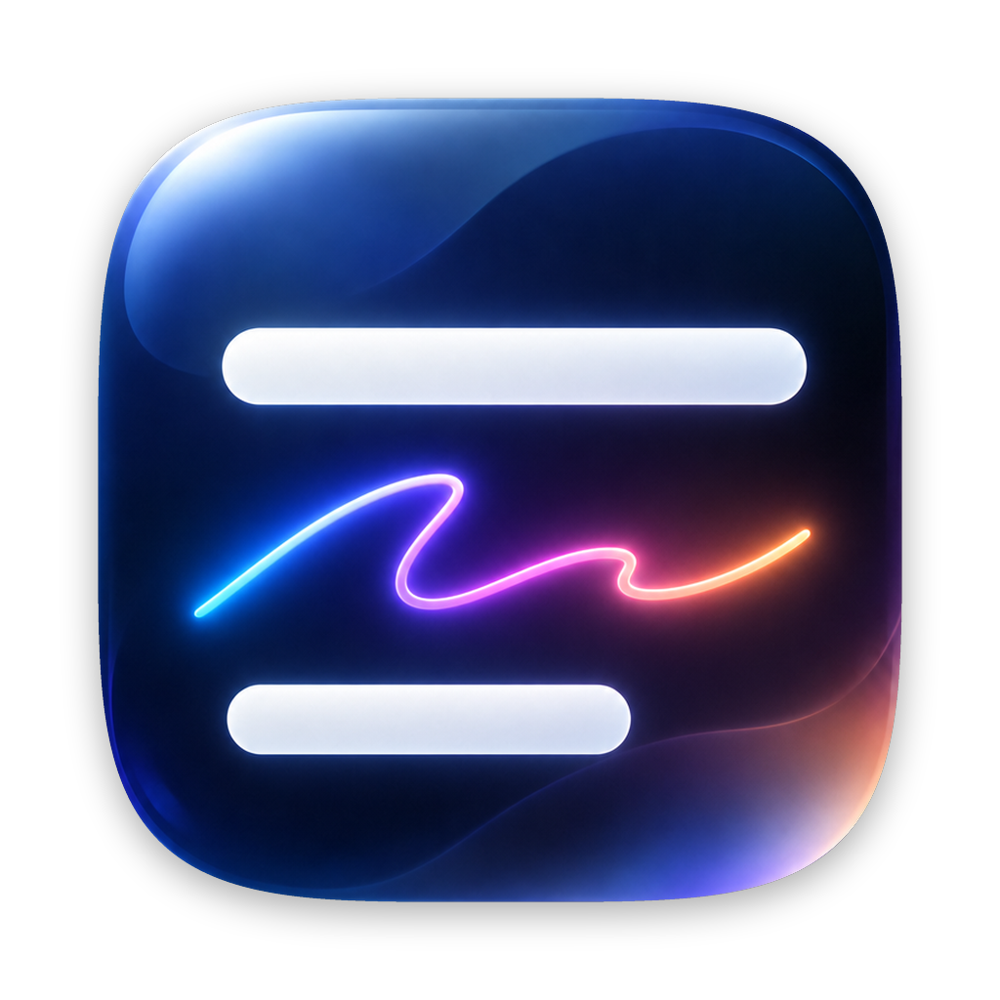
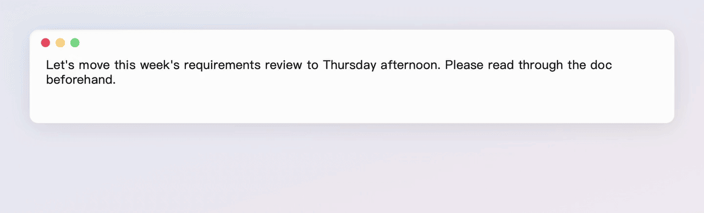
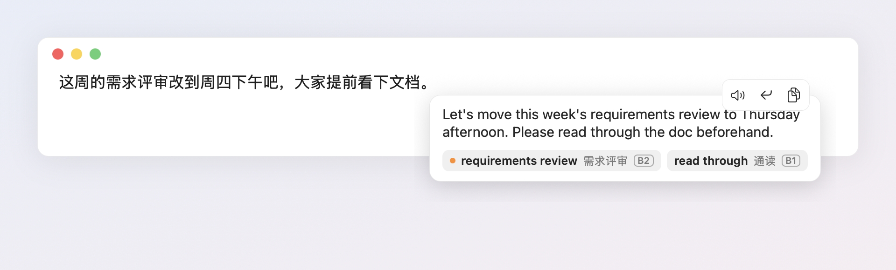
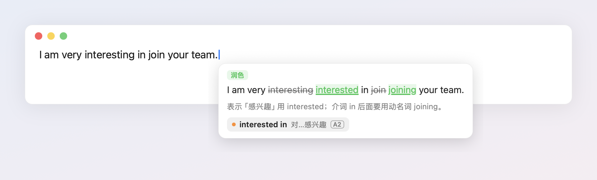
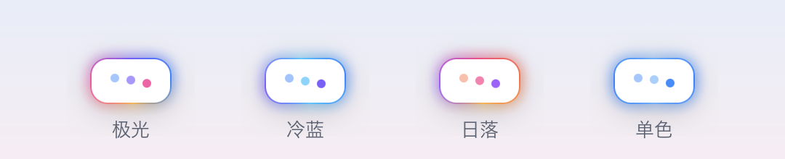
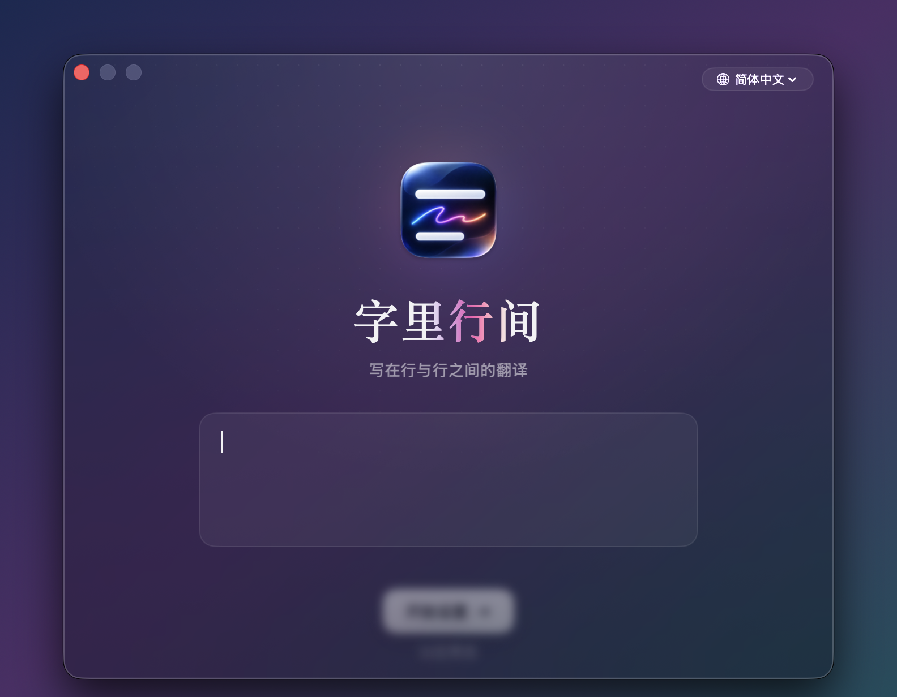
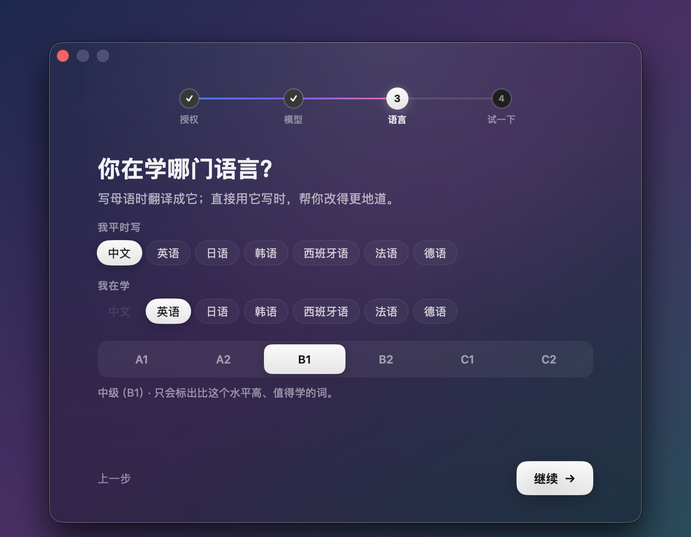
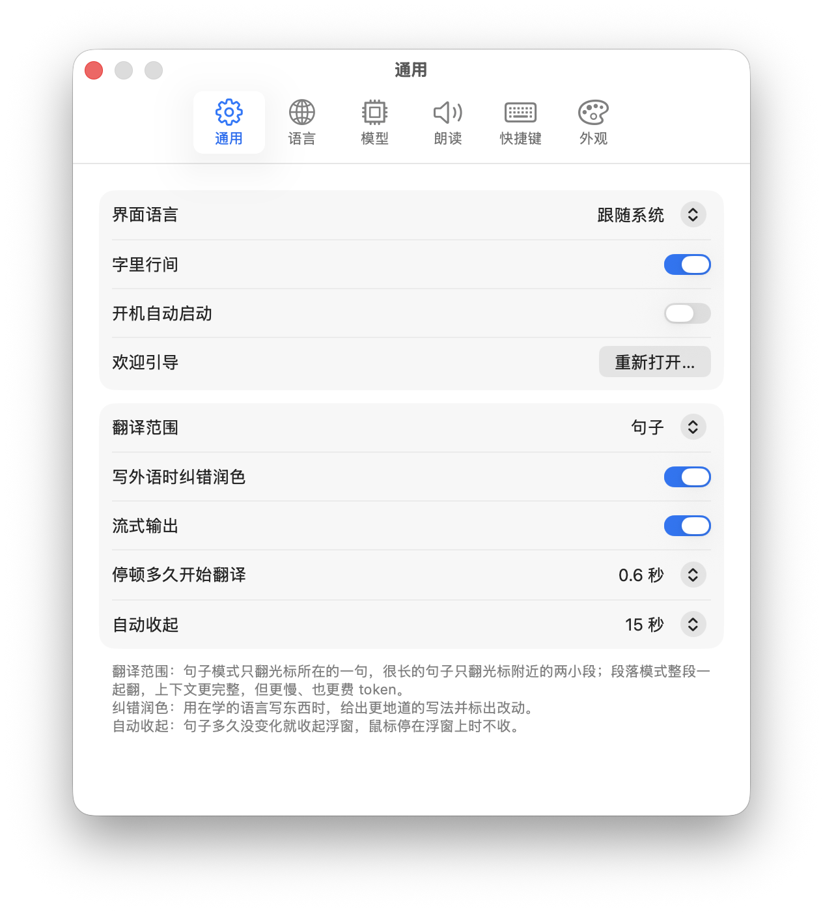

<p align="center">
  
</p>

<h1 align="center">字里行间 · Gloss</h1>

<p align="center">
  <b>打字时，顺手学外语</b><br>
  在任何 Mac 应用里打字，正在写的这句话的译文就出现在光标下面。
</p>

<p align="center">
  
  
  
  
</p>

<p align="center"><a href="README.md">English</a> · <b>简体中文</b></p>

<p align="center">
  
</p>

字里行间是一个 macOS 菜单栏小工具，给正在用外语写东西的人用。写母语，就能看到这句话用外语怎么说；写正在学的外语，它会帮你改得更地道。过程中遇到的生词会自动收集起来，方便之后复习。

英文名 Gloss 来自古代抄本里写在行与行之间的小字注释和翻译，中文名「字里行间」也是这个意思：译文就出现在你写的字的下面。

## 功能

**任意输入框都能用**：通过 macOS 辅助功能读取光标所在的句子，聊天软件、邮件、浏览器、编辑器里都能用，不用装插件。停顿一下（默认 0.6 秒）才开始翻译；拼音还没上屏时不翻；密码框、只读文字、只有一个链接的输入框都会跳过。

**流式出字**：模型思考时，浮窗边框有一圈彩色流光；译文出来后一个词一个词地打出来。

**替换、朗读、复制**：鼠标移到浮窗上会出现这三个按钮。也可以不碰鼠标：按 ⌃⌥E 把整句换成译文，按 ⌃⌥S 朗读，或者打开自动朗读。

<p align="center">
  
</p>

**写外语时纠错润色**：给出更地道的写法，删掉的词划线，加上的词标绿，再附一句为什么这么改。

<p align="center">
  
</p>

**自动积累生词**：模型按你的水平（CEFR A1～C2）挑出 0～3 个值得学的词。见过不到 3 次的生词前面有个橙点；点一下听发音，点 ✓ 标为已掌握。生词会在你继续写的过程中慢慢淡出，用着就是在复习。在生词本窗口里能查看、删除，也能导出到 Anki。

**回车发送后译文还在**：聊天时常常是打完字直接回车发送。刚发出去那句的译文会在原地多留几秒，标着「已发送」，来得及看一眼。

**按句子或按段落**：默认翻译光标所在的一句，特别长的句子只翻光标附近的两小段。切到段落模式会整段一起翻，上下文更完整。

**模型自己选**：支持 OpenAI 兼容接口，比如 DeepSeek、智谱 GLM、通义千问、Kimi、OpenAI，可以在设置里添加、编辑、切换。

**七种语言**：中文、英语、日语、韩语、西班牙语、法语、德语。翻译语言和软件界面都支持这七种。

**流光配色**：边框流光有四种配色可选。

<p align="center">
  
</p>

## 运行环境

- macOS 13 Ventura 及以上，Apple 芯片
- 一个 OpenAI 兼容模型服务的 API Key
- 辅助功能权限：读取和替换其他应用里的文字需要这个权限

## 安装

到 [Releases](https://github.com/evan-wu-dev/Gloss/releases) 下载 `Gloss-<版本>.zip`，解压后把 `Gloss.app` 拖进「应用程序」文件夹。

字里行间没有经过苹果公证，第一次打开会被系统拦下。放行方法：

- **macOS 15 Sequoia 及以上**：先打开一次，关掉提示；再到 **系统设置 → 隐私与安全性**，往下翻，在字里行间那一条旁边点 **仍要打开**。
- **macOS 13～14**：右键点 `Gloss.app`，选 **打开**，在弹窗里再点一次 **打开**。

也可以在终端里去掉隔离标记：`xattr -dr com.apple.quarantine /Applications/Gloss.app`。

装新版本后，系统会把它当成另一个应用来管辅助功能权限。如果更新后没反应了，到 **系统设置 → 隐私与安全性 → 辅助功能** 里把它关掉再打开。

### 从源码构建

先装好 Xcode 命令行工具（`xcode-select --install`），然后：

```bash
git clone https://github.com/evan-wu-dev/Gloss.git
cd Gloss
./scripts/build.sh
open dist/Gloss.app
```

构建脚本直接用 `swiftc` 编译，打包成 `dist/Gloss.app`，最后跑一遍自检，不需要 Xcode 工程。

默认用 ad-hoc 签名。macOS 的辅助功能授权认签名，所以每次重新构建后，都要到 **系统设置 → 隐私与安全性 → 辅助功能** 里把 Gloss 关掉再打开。想省掉这一步，可以用自己的证书签名，免费的 Apple Development 证书就行。可以在命令行里指定：

```bash
SIGNING_IDENTITY="Apple Development: Your Name (XXXXXXXXXX)" ./scripts/build.sh
```

也可以写进 `scripts/signing-identity`，只写一次就行，这个文件不会进 Git。要打发布用的 zip，运行 `VERSION=x.y.z ./scripts/release.sh`。

## 第一次使用

第一次打开会有一段欢迎引导，分四步：

1. 打开辅助功能权限。
2. 配置模型（可以先跳过，之后再配）。
3. 选择语言和水平。
4. 用示例句试一下。

<p align="center">
  
  
</p>

完成后窗口会飞进菜单栏图标，以后就在那里找它。想再看一遍引导，可以在 **设置 → 通用** 里重新打开。

菜单栏图标太多、找不到图标时，在 Spotlight 里再打开一次字里行间，会直接弹出设置窗口。

## 怎么用

| 想做的事 | 操作 |
| --- | --- |
| 把这句换成译文 | ⌃⌥E，或鼠标移到浮窗上后点 ↩ 按钮 |
| 朗读译文 | ⌃⌥S，或点喇叭按钮 |
| 复制译文 | 点复制按钮 |
| 听某个生词 | 点击这个词 |
| 标为已掌握 | 点词右边的 ✓，或右键点这个词 |
| 收起浮窗 | 按 Esc，或停 15 秒不动 |
| 暂时关掉 | 菜单第一行的开关，关掉后图标会变灰 |

两个快捷键都可以在 **设置 → 快捷键** 里改：点一下按钮，再按下新的组合键。

## 设置

<p align="center">
  
</p>

| 页面 | 内容 |
| --- | --- |
| 通用 | 界面语言、总开关、开机自动启动、欢迎引导、翻译范围（句子 / 段落）、纠错润色、流式输出、停顿多久开始翻译、自动收起时间 |
| 语言 | 母语、在学的语言、我的水平（CEFR A1～C2） |
| 模型 | 模型列表、切换当前使用的模型、添加 / 编辑 / 删除；「高级」里可以填额外参数 |
| 朗读 | 关闭 / 按快捷键 / 自动朗读，选声音、调语速、试听 |
| 快捷键 | 替换和朗读的快捷键 |
| 外观 | 流光配色：极光、冷蓝、日落、单色 |

所有设置都存在 `~/Library/Application Support/LiveTranslate/config.json`，也可以直接手动编辑。这个文件里有 API Key，创建时权限就设成了 `600`。

### 额外参数

有些模型会先「思考」再回答，翻译因此变慢。在 **模型 → 编辑 → 高级** 里可以填额外参数，它们会合并进每次请求。例如：

- DeepSeek：`{"reasoning_effort":"none"}`
- 智谱 GLM：`{"thinking":{"type":"disabled"}}`

如果接口不认这些参数，会自动去掉再重试一次。实测 DeepSeek 关掉思考后，一句大约 1.4 秒；不关大约 2.8 秒。

## 生词本和 Anki

生词按语言分别保存在 `~/Library/Application Support/LiveTranslate/vocab-<语言>.json`。一句话写完才算「见过」一次，写到一半停顿不重复计数。

用着就是在复习：生词在浮窗里出现、你没点它听发音，就算记得一次，隔 1、3、7、15、30 天才会再提示，隔完自动算掌握；点了听发音会从头再来。用在学的语言自己写出来的词直接算掌握；不高于你水平的词不会提示。

点菜单里的 **生词本…**，分「学习中 / 已掌握」两栏列出所有生词，可以搜索、听发音、标为已掌握或移回学习中、删除（可多选后按 Delete）。窗口里的 **导出到 Anki…**会在「下载」文件夹生成一个用制表符分隔的文件。在 Anki 里选 **文件 → 导入**，选中这个文件即可。卡片正面是单词；背面是释义、你当时写的那句话和它的译文。Anki 按卡片正面识别重复，按默认导入选项再导入一次时，已有的卡片会更新，不会重复。

## 隐私

- 光标所在的句子只会发给你自己配置的模型服务，字里行间没有自己的服务器。
- 密码输入框一律不读。
- API Key 只保存在本机的配置文件里。

## 已知限制

- **网页技术做的终端**（比如 Orca 等基于 xterm.js 的终端）不会把你正在输入的那一行暴露出来，字里行间只能读到片段，所以可能只翻译出半句。
- 少数 Electron / Chromium 应用不支持通过辅助功能选中文字，这时会改用 ⇧← 选中再粘贴的方式替换。
- 目前只构建 Apple 芯片版本。

## 开发

```
Sources/
  main.swift                  应用入口、主循环、菜单、自检
  Accessibility.swift         读取聚焦的输入框、光标位置、替换文字
  Sentence.swift              取光标所在的句子、判断拼音组字
  Language.swift              支持的语言和语言识别
  LLMClient.swift             OpenAI 兼容接口、流式（SSE）、提示词
  Overlay.swift               浮窗：流光、逐字出现、悬停工具栏、生词标签
  Diff.swift                  润色前后按词对比
  Settings.swift              设置窗口（SwiftUI）
  Onboarding.swift            欢迎引导（SwiftUI）
  Demo.swift                  --demo 演示模式，调样式和生成 README 素材用
  Localization*.swift         七种语言的界面文案
  Vocab.swift / Speech.swift  生词本、朗读
assets/AppIcon-1024.png       应用图标源图（构建时生成 AppIcon.icns）
scripts/build.sh              构建、签名、自检
scripts/release.sh            打发布用的 zip（ad-hoc 签名）
scripts/make-readme-media.sh  重新生成 docs/images 里的截图和动图
```

不想真的去打字、只想看看浮窗效果，可以运行：

```bash
dist/Gloss.app/Contents/MacOS/Gloss --demo <waiting|streaming|done|polish|hero|toolbar> [aurora|ocean|sunset|mono] [--lang zh]
```

README 里的图都是用这个演示模式录的。要重新生成，运行 `scripts/make-readme-media.sh`。这个脚本需要 `ffmpeg` 和 ImageMagick，终端还要有「屏幕录制」权限。

## 开源协议

[MIT](LICENSE)
